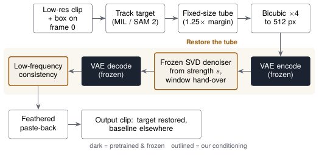
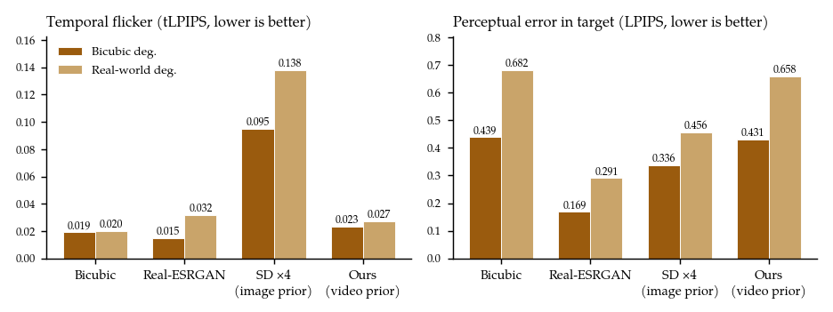
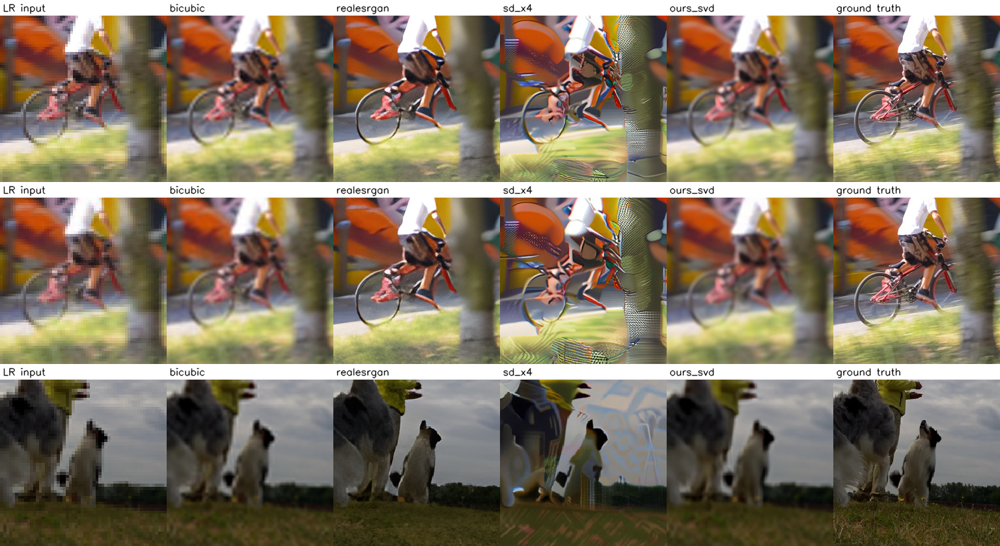

# Targeted Super-Resolution of Content in Video Clips using Video-Diffusion Models

IE 643 course project · Team Pairadox · Avishi (23B2523)

Mark a target (a face, a sign, an object) on the first frame of a low-resolution clip, and get that region super-resolved ×4 consistently across the whole clip, with a side-by-side comparison against a baseline. The restoration uses **Stable Video Diffusion as a frozen prior**: nothing is trained; the low-resolution target steers the model.

The full write-up is in [`report/Pairadox_IE643_Final_Report.pdf`](report/Pairadox_IE643_Final_Report.pdf).



## How it works

1. **Track** the user's frame-0 box through the clip (OpenCV MIL, or SAM 2).
2. **Cut a tube**: a fixed-size square crop that follows the target (1.25× margin, side a multiple of 32 px, constant within a window so it never zooms).
3. **Restore the tube with frozen SVD** (`stabilityai/stable-video-diffusion-img2vid`), steered by the low-resolution input in three ways:
   - *partial-noise start*: encode the bicubic-upsampled tube and denoise only from strength `s` (SDEdit-style) instead of from pure noise;
   - *window hand-over*: 14-frame windows overlap by one frame, and each window is conditioned on the previous window's restored frame;
   - *low-frequency consistency*: coarse structure and colour come from the input, only fine detail from the prior.
4. **Paste back** with a feathered border into the baseline-upscaled frame.

## Results (DAVIS 2017, 8 test targets per degradation, metrics inside the target)

| Bicubic degradation | PSNR ↑ | SSIM ↑ | LPIPS ↓ | tLPIPS ↓ |
|:--|--:|--:|--:|--:|
| Bicubic | **24.99** | **0.704** | 0.439 | 0.019 |
| Real-ESRGAN (per frame) | 23.07 | 0.685 | **0.169** | **0.015** |
| SD ×4 image prior | 21.82 | 0.577 | 0.336 | 0.095 |
| **Ours (SVD video prior, s = 0.3)** | 24.56 | 0.682 | 0.431 | 0.023 |

| Real-world degradation | PSNR ↑ | SSIM ↑ | LPIPS ↓ | tLPIPS ↓ |
|:--|--:|--:|--:|--:|
| Bicubic | **22.15** | 0.549 | 0.682 | **0.020** |
| Real-ESRGAN (per frame) | 21.38 | **0.558** | **0.291** | 0.032 |
| SD ×4 image prior | 20.35 | 0.457 | 0.456 | 0.138 |
| **Ours (SVD video prior, s = 0.3)** | 22.02 | 0.540 | 0.658 | 0.027 |

The video prior flickers 4–5× less than a per-frame image diffusion prior and stays much closer to the true content, but at this conservative strength it adds little sharpness over bicubic. Increasing sharpness without losing fidelity is the next step. See the report for the full tables, the validation study and the discussion.




## Repository layout

```
tsr/                 library code
  io.py              frame and video I/O
  degrade.py         clip-consistent degradations (bicubic, real-world)
  tubes.py           mask → smoothed box → fixed-size tube
  targets.py         target masks: DAVIS annotations, MIL tracker, SAM 2, YOLO
  vprior.py          our method: frozen SVD prior steered by the target
  targeted.py        full-frame pipeline: track, restore, feathered paste-back, seam metric
  metrics.py         region PSNR/SSIM/LPIPS, tLPIPS, warping error
  baselines/         bicubic, Real-ESRGAN, SD ×4 upscaler
scripts/
  analyze_dataset.py DAVIS statistics and data-driven test/val target selection
  build_dataset.py   paired LR/HR target tubes
  run_baseline.py    run any method on a split (resumable, multi-GPU sharding)
  evaluate.py        metrics table (results/summary.md)
  make_figures.py    qualitative grids, temporal profiles, runtime chart
app.py               Gradio demo / test interface
notebooks/
  kaggle_selfcontained.ipynb      the full pipeline as one notebook (Kaggle, 2× T4)
  final_run_kaggle_executed.ipynb the executed run behind the reported results
  run_all.ipynb                   Colab version
configs/boxes_exp1.json  target box for the Experiment 1 clip
tests/smoke_test.py      CPU end-to-end test on synthetic data
figures/, report/        figures and the final report
```

## Running it

**Easiest (Kaggle):** import `notebooks/kaggle_selfcontained.ipynb`, set Accelerator to *GPU T4 x2*, turn Internet on, add a Hugging Face read token as the secret `HF_TOKEN` (after accepting the licence on the [SVD model page](https://huggingface.co/stabilityai/stable-video-diffusion-img2vid)), and run all cells. It downloads DAVIS, selects targets, tunes on validation, runs all methods on test and writes the metrics and figures.

**Locally (NVIDIA GPU with ≥ 12 GB):**

```bash
pip install -r requirements.txt
python tests/smoke_test.py                       # CPU sanity check
# DAVIS 2017 TrainVal 480p: https://davischallenge.org/davis2017/code.html → data/raw/DAVIS
python scripts/analyze_dataset.py --root data/raw/DAVIS --out analysis
python scripts/build_dataset.py --preset davis --root data/raw/DAVIS --out data/tubes \
    --clip-list analysis/selected_test.txt --list-split test --clip-len 27 --max-windows 1
python scripts/run_baseline.py --data data/tubes/test --methods bicubic realesrgan sd_x4 ours_svd --svd-strength 0.3
python scripts/evaluate.py --data data/tubes/test --results results
```

**Demo:** `python app.py --share`, then upload a clip, click two corners of the target on frame 0, and press *Restore*. *HD clip* mode degrades the upload itself and shows target-region metrics; *low-resolution clip* mode restores a real input.

## Credits

Built on [diffusers](https://github.com/huggingface/diffusers), [Stable Video Diffusion](https://huggingface.co/stabilityai/stable-video-diffusion-img2vid) and the [Stable Diffusion ×4 upscaler](https://huggingface.co/stabilityai/stable-diffusion-x4-upscaler) (Stability AI), [Real-ESRGAN](https://github.com/xinntao/Real-ESRGAN) weights loaded with [spandrel](https://github.com/chaiNNer-org/spandrel), [DAVIS 2017](https://davischallenge.org/), [LPIPS](https://github.com/richzhang/PerceptualSimilarity), [pyiqa](https://github.com/chaofengc/IQA-PyTorch), OpenCV and Gradio. Model weights and datasets are downloaded at runtime and are not redistributed here; they remain under their own licences.
